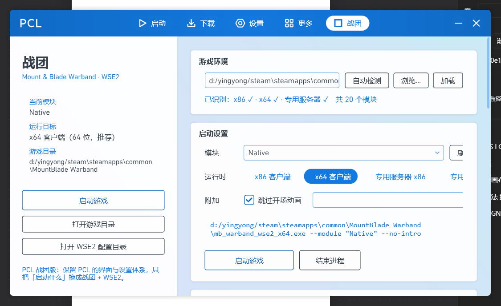

# PCL 战团版（PCL Warband）

> 一个基于 [PCL2](https://github.com/Hex-Dragon/PCL2) 源码的**第三方二次创作**：保留 PCL2 的界面、主题、设置体系与更新框架，把「启动什么」从 Minecraft 换成**《骑马与砍杀：战团》（Mount & Blade Warband）+ WSE2**。



| | |
|---|---|
| 上游 | [Hex-Dragon/PCL2](https://github.com/Hex-Dragon/PCL2)（作者：龙腾猫跃） |
| 本作性质 | 第三方修改版，与 PCL 官方、TaleWorlds、WSE2 作者均无关联 |
| 技术栈 | 沿用上游：VB.NET / WPF / .NET Framework 4.8（项目文件已改为 SDK 风格，可不装 Visual Studio 直接 `dotnet build`） |
| 许可 | 继续适用上游《PCL 分发有限许可》与《PCL 存储库合理使用指南》，见 [LICENCE](LICENCE) |

## 它做了什么

在 PCL2 的框架里新增一个「战团」主页面（顶部导航第 6 个标签），并把战团 / WSE2 的启动链路接到 PCL 的页面、控件、设置与提示体系上：

1. **直接调用 WSE2 自带的三个构建**，不注入、不替换、不改动任何游戏文件，因此 WSE2 的性能特性（多线程渲染、Bullet/Havok 物理、LuaJIT 脚本扩展）原样保留：
   - `mb_warband_wse2.exe --module "<模块文件夹名>" --no-intro`
   - `mb_warband_wse2_x64.exe --module "<模块文件夹名>" --no-intro`
   - `mb_warband_wse2_dedicated[_x64].exe --config-path server_config.ini -r "<模块文件夹名>.txt" --module "<模块文件夹名>"`
2. **自动定位游戏**：读 Steam 注册表 + `libraryfolders.vdf`，兜底扫盘符，找不到可手动选目录。
3. **模块扫描**：遍历 `Modules\*`，解析 `module.ini` 的 `module_name` / `compatible_with_warband`，统计 `Resource` 体积并按体积排序提示。
4. **WSE2 配置中心**：直接编辑 `Documents\Mount&Blade Warband WSE2\rgl_config.ini`，提供低配 / 均衡 / 高画质三套预设与 16 个关键项（按需纹理、纹理质量、MSAA、帧率上限、阴影贴图、尸体/布娃娃上限、任务线程数、FXAA、声音滤波……）。写入前**自动备份**，再用临时文件**原子替换**，避免写坏配置。
5. **启动前体检**：`steam_appid.txt` 是否为 48700、WSE2 依赖 DLL 是否齐全、32 位构建的 2GB 地址空间风险、模块里 ≥512MB 的畸形 `.brf` 告警。
6. **崩溃速诊**：读 `rgl_log.txt` 尾部，按已知特征给出人话结论（`0xE0000006` 内存耗尽、面部网格缺失被升级成致命错误、Bullet 多线程碰撞访问违例、模块与本体版本不匹配……）。

## 构建

不需要 Visual Studio，只要 .NET SDK（10.0 已测试）：

```powershell
git clone https://github.com/WWL221/PCL-Warband.git
cd PCL-Warband
dotnet build "Plain Craft Launcher 2\Plain Craft Launcher 2.vbproj" -c Release
```

产物：`Plain Craft Launcher 2\bin\Release\net48\Plain Craft Launcher 2.exe`（需要 .NET Framework 4.8，Windows 10 1809+ 自带）。

想一步装好并建桌面快捷方式（会把程序复制到固定目录，避免被重新构建冲掉）：

```powershell
powershell -ExecutionPolicy Bypass -File .\scripts\install-desktop-shortcut.ps1
# 自定义安装目录：
powershell -ExecutionPolicy Bypass -File .\scripts\install-desktop-shortcut.ps1 -TargetDir "D:\game\PCL-Warband"
```

> 上游原本是 VS2015+ 老式 vbproj，本仓库把它改成了 SDK 风格（原文件保留为 `Plain Craft Launcher 2.vbproj.legacy` 以便对照），并补齐了老式项目里手写的 `Import`、`Resource`、`None` 项，所以 `dotnet build` 能直接编出 WPF 程序。

## 使用

1. 打开启动器 → 顶部「战团」标签（默认页）。
2. 「自动检测」定位游戏目录（也可手动「浏览…」）。
3. 选模块 → 选运行时（x64 推荐）→ 需要的话勾「跳过开场动画」、填附加参数。
4. 点「启动游戏」。下方「启动前体检」会先给出检查项，出问题点「崩溃速诊」看日志结论。
5. 想调画面/性能：页面下半部分「WSE2 性能配置」直接改 `rgl_config.ini`，或先套一个预设。

## 配置文件位置

| 内容 | 路径 |
|---|---|
| 启动器自身设置 | `<程序目录>\PCL\Setup.ini`（由 PCL 框架管理） |
| 本页面新增设置 | `%APPDATA%\PCL Warband\warband.txt` |
| WSE2 运行配置 | `文档\Mount&Blade Warband WSE2\rgl_config.ini` |
| 配置备份 | 同目录 `rgl_config.ini.bak_yyyyMMdd_HHmmss`（保留最近 10 份） |
| 游戏日志 | `<游戏目录>\rgl_log.txt`、`Logs\` |

## 相对上游的改动

见 [CHANGES-WARBAND.md](CHANGES-WARBAND.md)，一句话概括：新增 3 个文件（`Modules\Warband\ModWarband.vb`、`Pages\PageWarband\*`）、改 4 个上游文件（`FormMain.xaml(.vb)`、`Modules\ModMain.vb`、项目文件），其余源码未动。

## 常见问题

- **点启动没反应 / 一闪而过**：先看「崩溃速诊」。WSE2 用 `WSE2 Mutex` 做单实例，残留进程会挡住启动，任务管理器结束 `mb_warband_wse2*.exe` 后重试。
- **x86 崩溃、x64 正常**：x86 构建没有 LARGEADDRESSAWARE，堆到 2GB 就会以 `0xE0000006` 结束；战团大型 mod 的 `Resource` 动辄数 GB，请用 x64。
- **启动就报致命错误、日志里有 `Unable to find ... mesh`**：模块资源不完整（常见于面部/头部网格），Steam 验证文件完整性或重新解压该模块。
- **提示没有 module.ini**：`Modules\<文件夹>` 下必须有 `module.ini`，否则不是有效模块。
- **这是不是修改了游戏文件？** 不是。启动器只调用 WSE2 的 exe，并读写 `rgl_config.ini`（带备份）。

## 免责声明

本程序按上游许可与 MIT 精神开源，**使用风险自负**；联机服务器是否允许使用 WSE2 请以该服务器规则为准。本项目不联网、不收集遥测，也不会修改存档。

## 致谢

- [PCL2](https://github.com/Hex-Dragon/PCL2) —— 龙腾猫跃（界面、主题、设置与更新框架全部来自上游）
- [WSE2](https://github.com/Swyter/wse2) —— Swyter 及贡献者
- [MeloongCore](https://github.com/Meloong-Git/MeloongCore) —— 上游依赖库（Apache-2.0）
- 《骑马与砍杀》系列版权归 TaleWorlds Entertainment 所有
